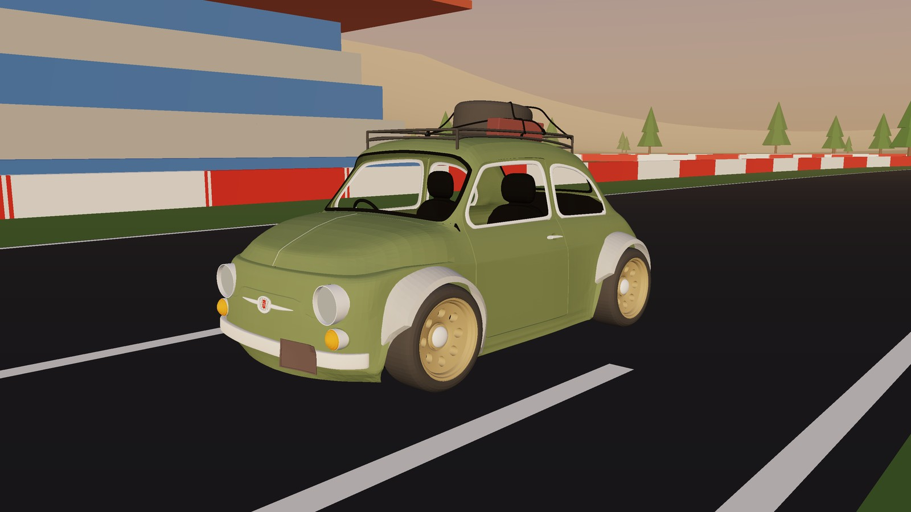
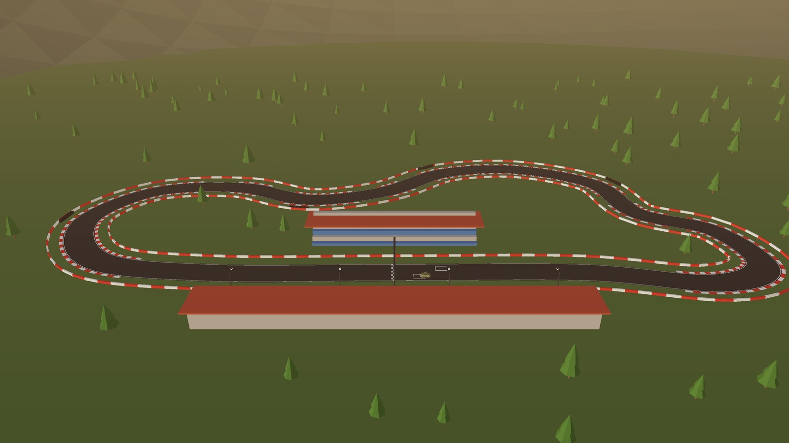

<p align="center">
  
</p>

<p align="center">
  <b>A game engine for Apple silicon, built on Metal.</b><br>
  C++, open source, with an editor. For Mac, iPad and iPhone, and nothing else.
</p>

<p align="center">
  
</p>

Molten targets one family of machines (Apple GPUs) so that it can use what they offer without a layer of compromise in between: tile-based rendering, memoryless render targets, unified memory, hardware ray tracing. Gameplay is written in C++ as small components, or drawn as visual scripts, and edited in an editor that will feel familiar if you have used Unity, without being a copy of it.

> **Status: 1.0, young.** What is described here exists today; [ROADMAP.md](ROADMAP.md) says what is next and what is not finished. Molten grew out of the engine of the [LearnMetal](https://gabrielevierti.github.io/learnmetal/) tutorials.

## The example game: Driving

<table>
  <tr>
    <td width="50%"></td>
    <td width="50%"></td>
  </tr>
</table>

A little Fiat 500 on a small circuit, to lap against the clock, on a Mac with the keyboard or on an iPhone with your thumbs. It is a complete project made with the editor, and the best way to see what the engine does:

- **A car simulated from its parts.** Four wheels with springs, dampers and anti-roll bars; tires that grip, slide, smoke and leave marks; a turbocharged four-cylinder behind a gearbox, with the whistle and the blow-off; stability control that lets it drift and catches it; ABS and a handbrake for the hairpin. Upside down, it is put back on its wheels.
- **A circuit to learn.** 566 meters of corners with curbs and walls, a stand, a start gantry and a pit lane in front of the garages, in evening light. Four wheels on the grass and the lap does not count.
- **Tyres and pit stops.** Soft, medium, hard and wet tyres that wear as you drive, more when they slide. Stop in your box in the pit lane, behind the limiter, and the crew changes them for the ones you choose.
- **Weather.** Sun, clouds, rain, or a sky that changes as you race: the rain falls, the road darkens, shines and loses its grip, and dries again when it stops.
- **Lap times and menus.** Your lap, your last and your best (kept from one game to the next) on a dashboard with speed, revs, gear and boost; a title screen, a pause menu, and settings for the graphics, the weather, the tyres, the size of the touch buttons, ABS and the sound.
- **Lights and smoke.** Headlights (L), brake lights that glow when you brake, particle smoke from the exhaust that follows the throttle, and from the rear tires when they let go.
- **Touch controls.** Two steering buttons on the left; gas, brake and handbrake on the right. On a phone they are there from the start. On the Mac, T shows them and the mouse plays the finger.

<p align="center">
  
</p>

The game is not part of the engine: download **`MoltenProjects.zip`** from the releases, unzip it wherever you keep your projects and open `Driving` (or `Showcase`) from the editor. Everything in it is ordinary: the scene, the materials, the interface laid out in the Game view, and its own scripts in `Assets/Scripts` (`LapTimer.cpp`, `CarLights.cpp`, `Exhaust.cpp`…). The unit tests drive it without a screen: a stop from speed that has to stay straight, and three laps by an autopilot that has to stay on the road.

Next to it, the **Showcase** project is a plaza of everything Molten does, to drive around in the same car: materials from smooth to rough, hand-written shaders (a lava lake, a hologram), a hall of colored lights, every particle effect, physics with joints (dominoes, a wrecking ball, a row of hanging balls, gates on hinges), ramps with mesh colliders, a basin of ocean waves with things floating on it, tanks of liquid, and stars to collect, picked up by a visual script.

The car is ["Fiat 500 x Outlaw"](https://sketchfab.com/3d-models/fiat-500-x-outlaw-f412bdec4b494692b9d5d9c03f4178ad) by [Subin](https://sketchfab.com/subink), licensed under [CC-BY-4.0](http://creativecommons.org/licenses/by/4.0/).

*The pictures above come from the editor's own software preview renderer, not from Metal: the game looks better than this on a Mac.*

## Build and run

You need a Mac with Apple silicon, **macOS 13+**, **Xcode 15+** (or its command line tools) and **CMake 3.24+** (`brew install cmake`).

```sh
cmake -B build -DCMAKE_BUILD_TYPE=Release
cmake --build build -j
./build/molten                      # the editor
./build/molten-player MyGame        # runs a project without the editor
```

Or double-click `build.command` in the Finder: it builds everything and writes what happened to `build.log`. The first configuration downloads the libraries Molten uses: GLFW, metal-cpp, stb, miniaudio, Dear ImGui and ImGuizmo.

## The editor

`./build/molten` opens the list of projects: make a new one, or open one you have (Cmd+O opens projects and scenes alike).

- **Hierarchy, Scene, Game, Inspector, Explorer, Console**, docked side by side as in Unity and rearranged by dragging tabs; layouts can be saved, exported and imported. The console sorts errors, warnings, info and debug messages, collapses repeats and searches. The game runs in the Game view while the Scene view keeps its own camera; Stop puts everything back as it was. Keys reach the game only while the Game view has focus.
- **The 3D view.** Move, rotate, scale, or all three (W, E, R, T), in world or local axes, with snapping. Right button and W A S D fly, Alt-drag orbits, F frames the selection. "Colliders" shows what is solid.
- **Assets.** Folders and tiles with real previews: models, scenes, materials as lit balls. Drag a model into the view to place it; drag a material onto an object (it shows on whatever is under the pointer before you let go) or onto its row in the Hierarchy. Right-click to create anything the + New menu offers.
- **The Viewer.** Look into an asset before using it: a model turned around, a material and all its maps, a sound with tools to trim, fade, loop and normalize it, a particle effect playing. Import settings for pictures, models and sounds are kept in the file's `.meta`.
- **Materials and shaders.** A material is an asset: lit, unlit, water, or a shader of your own (`.shader`, a surface function and its properties), compiled when you save it.
- **Interface pieces.** Text, panels, pictures, bars, dials, buttons (round ones for touch) and a touch stick, scaled with the screen as Unity's Canvas Scaler does, created from the Hierarchy and laid out by dragging in the Game view, with anchors. Choose an iPhone or iPad shape in the Game view to see the layout as it will be there.
- **Undo for everything**, a console that collects what the engine and the game say, and a layout remembered between sessions.
- **Build and Export.** One window, in steps: the game's settings and icon, then a Mac application, or an iPhone/iPad build put on your device without leaving the editor.

## Writing a game

A game's code is C++ in `Assets/Scripts`: every `.cpp` there is built into the game, and rebuilt when you save. A component is a plain struct followed by one line that declares it; its fields appear in the inspector and are saved in scenes, its `update` runs when you press Play.

```cpp
#include "MoltenMetal.hpp"
using namespace molten;

struct Spinner {
    float degreesPerSecond = 90;        // shown and edited in the inspector

    void update(World& world, Entity self, float dt) {
        if (Transform* transform = world.scene.get<Transform>(self))
            transform->rotation = transform->rotation * Quat(radians(degreesPerSecond * dt), Vec3{0, 1, 0});
    }
};

MOLTEN_COMPONENT(Spinner, MOLTEN_FIELD(degreesPerSecond).range(-720, 720))
```

The same behaviors can be drawn instead of written: visual scripts, with about forty nodes for events, movement, physics, input, math and variables, a board that zooms and searches, and a way to C++ and back. And many things need no code at all: the engine comes with components for a player that moves, a camera that follows, pickups, health and damage, shooting and spawning, a score on screen, and whole vehicles.

[Docs/MakingGames.md](Docs/MakingGames.md) is the tour, [Docs/GameCode.md](Docs/GameCode.md) the code, [Docs/VisualScripting.md](Docs/VisualScripting.md) the nodes, [Docs/Plugins.md](Docs/Plugins.md) how to extend the editor.

## The engine

**Rendering.** Physically based materials in HDR with multisampling; a sun with cascaded shadow maps and up to 63 point and spot lights; ray-traced shadows, ambient occlusion, reflections and one bounce of light on GPUs that trace rays; image-based lighting from the sky; normal maps, cut-out and transparent materials; a sky with clouds, fog with light shafts, water; bloom, tone mapping, ambient occlusion, lens effects. Shaders are reloaded when saved.

**Effects.** Particles with shapes, bursts, turbulence, a wind that carries them and floors they bounce on; nine presets to start from, saved as `.effect` files.

**Physics.** Bodies that turn, contacts at points, joints; spheres, boxes, capsules and mesh colliders; triggers, raycasts, layers; vehicles built from wheels, suspensions, engines and wings.

**Everything else.** Entities and components with parent-child transforms; keyboard, mouse, gamepad and touch behind named actions; a sound mixer; glTF and OBJ models (a glTF's parts usable one by one, `car.glb#3`); scenes as text that reads well in a diff; `--capture file.png` to run a program without a window and save a frame.

[ARCHITECTURE.md](ARCHITECTURE.md) explains how the parts fit together and why.

## iPhone and iPad

The engine runs on iOS and iPadOS 16 and later. The editor's Build window makes the Xcode project, builds it and puts the game on a connected device; you need your Apple developer team's ID once. By hand it is:

```sh
cmake -B build-ios -G Xcode -DCMAKE_SYSTEM_NAME=iOS -DMOLTEN_IOS_PROJECT=/path/to/MyGame -DMOLTEN_IOS_TEAM=YOURTEAMID
open build-ios/MoltenMetalEngine.xcodeproj
```

[Docs/iOS.md](Docs/iOS.md) has the details and what is still missing there.

## Layout

```
Engine/      the engine: Core, Scene, Rendering, Physics, Audio, Input, Assets, Project, Kit, Platform
Editor/      the editor; Editor/API is what plugins include
Player/      the program a game is, on the Mac and on iOS
Plugins/     editor plugins that come with Molten (an example)
Shaders/     Metal shaders, and the header that C++ and the shaders share
Assets/      the engine's own assets: the default font, the logo and icon, a sample scene
Tests/       unit tests
Templates/   project folders put here are offered as starting points
Tools/       scripts that make the assets and the example project
```

## License

GPL-3.0: see [LICENSE](LICENSE). The libraries Molten downloads keep their own licenses (MIT, zlib, public domain, Apache 2.0 for metal-cpp). The example game's car is CC-BY-4.0, as credited above.
