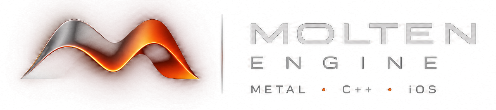

 <p align="center">
  
</p>

<p align="center">
  <strong>A game engine for Apple silicon, built on Metal.</strong><br>
  C++ · Open Source · Visual Editor · macOS · iOS · iPadOS
</p>

<p align="center">
  
</p>

Molten Engine is a native game engine designed exclusively for Apple's hardware.

Built on Metal and written in C++, it takes advantage of Apple silicon features such as tile-based rendering, memoryless render targets, unified memory and hardware-accelerated ray tracing.

Create games using C++ components or visual scripting, build scenes in a fully featured editor, and deploy to Mac, iPhone and iPad.

No Windows. No Linux. No compatibility layers. Just Apple hardware and Metal.

**Status: Version 1.0 — Early development.**

The features described here are implemented and available today. See [ROADMAP.md](ROADMAP.md) for upcoming work and known limitations.

Molten Engine grew out of the engine developed for the [LearnMetal](https://gabrielevierti.github.io/learnmetal/) tutorials.

## Getting started

### Requirements

- Mac with Apple silicon.
- macOS 13 or later.
- Xcode 15 or later, or Xcode Command Line Tools.
- CMake 3.24 or later.

Install CMake using Homebrew:

```sh
brew install cmake
```

### Build

Clone the repository and build the engine:

```sh
cmake -B build -DCMAKE_BUILD_TYPE=Release
cmake --build build -j
```

Launch the editor:

```sh
./build/molten
```

Launch a game without the editor:

```sh
./build/molten-player MyGame
```

Alternatively, double-click `build.command` in Finder. The script builds the project and saves the output to `build.log`.

On the first configuration, CMake downloads the required dependencies:

- GLFW
- metal-cpp
- stb
- miniaudio
- Dear ImGui
- ImGuizmo

## The editor

Molten Engine includes a complete visual editor designed to make game development accessible without sacrificing control.

Its interface follows familiar workflows while remaining purpose-built for the engine.

### Workspace

- Hierarchy, Scene, Game, Inspector, Explorer and Console panels.
- Dockable and rearrangeable tabs.
- Save, export and import editor layouts.
- Console with categorized messages, search and duplicate collapsing.
- Independent Scene and Game cameras.
- Play and Stop controls with scene state restoration.

### Scene editing

- Move, rotate and scale tools.
- World and local coordinate modes.
- Transform snapping.
- Fly camera with WASD and right mouse button.
- Alt-drag orbit controls.
- Frame selected objects with F.
- Collider visualization.

### Asset management

- Folder and tile-based asset browser.
- Automatic previews for models, scenes and materials.
- Drag-and-drop model placement.
- Material assignment directly onto objects.
- Asset creation through the context menu.
- Persistent import settings stored in `.meta` files.

### Asset Viewer

Preview and inspect assets before using them:

- 3D models.
- Materials and texture maps.
- Audio files with trimming, fading, looping and normalization.
- Particle effects with live playback.

### Materials and shaders

Create and edit materials directly in the editor.

Supported material types include:

- Physically based materials.
- Unlit materials.
- Water materials.
- Custom shaders written in `.shader` files.

Shaders are compiled automatically when saved.

### UI editor

Build game interfaces using:

- Text and panels.
- Images and progress bars.
- Dials and buttons.
- Touch buttons and virtual sticks.
- Anchors and responsive scaling.

UI elements can be positioned directly in the Game view.

The editor also provides iPhone and iPad screen presets for previewing layouts across devices.

### Undo and workflow

- Undo support for editor operations.
- Centralized engine and game logging.
- Persistent workspace layouts.
- Integrated project management.

### Build and export

Build and deploy games through a dedicated editor window.

Supported targets:

- macOS applications.
- iOS applications.
- iPadOS applications.

The iOS build workflow generates the Xcode project, builds the application and installs it on a connected device.

## Writing games

Games are written in C++ using components.

Every `.cpp` file inside `Assets/Scripts` is automatically compiled into the game. Saving a script triggers a rebuild.

A component is a regular C++ struct with a simple declaration:

```cpp
#include "MoltenMetal.hpp"
using namespace molten;

struct Spinner {
    float degreesPerSecond = 90;

    void update(World& world, Entity self, float dt) {
        if (Transform* transform = world.scene.get<Transform>(self))
            transform->rotation = transform->rotation *
                Quat(radians(degreesPerSecond * dt), Vec3{0, 1, 0});
    }
};

MOLTEN_COMPONENT(
    Spinner,
    MOLTEN_FIELD(degreesPerSecond).range(-720, 720)
)
```

Component fields are automatically exposed in the Inspector and serialized with the scene.

The `update` method is called every frame while the game is running.

### Visual scripting

Prefer building gameplay visually?

Molten Engine also includes a visual scripting system with approximately 40 nodes covering:

- Events and logic.
- Transform operations.
- Physics.
- Input.
- Mathematics.
- Variables.

The visual scripting editor supports zooming, searching and interaction with C++ components.

### Built-in gameplay systems

Many common gameplay mechanics are available without writing custom code:

- Player movement.
- Follow cameras.
- Pickups and collectibles.
- Health and damage.
- Shooting and spawning.
- Score systems.
- Vehicle controllers.

### Documentation

- [Making Games](Docs/MakingGames.md)
- [Game Code](Docs/GameCode.md)
- [Visual Scripting](Docs/VisualScripting.md)
- [Editor Plugins](Docs/Plugins.md)

## Engine features

### Rendering

A Metal-based rendering pipeline designed for Apple GPUs.

- Physically based rendering (PBR).
- HDR rendering and multisampling.
- Cascaded shadow maps.
- Directional, point and spot lights.
- Up to 63 point and spot lights.
- Hardware ray-traced shadows.
- Ray-traced ambient occlusion.
- Ray-traced reflections.
- Single-bounce ray-traced lighting.
- Image-based lighting.
- Normal maps.
- Transparent and cutout materials.
- Procedural sky, clouds and fog.
- Volumetric light shafts.
- Water rendering.
- Bloom and tone mapping.
- Lens effects.

### Particles and effects

A flexible particle system with:

- Shape-based emission.
- Burst emission.
- Turbulence.
- Wind forces.
- Collision with floors.
- Nine built-in presets.
- Reusable `.effect` assets.

### Physics

A physics system supporting:

- Rigid bodies and contacts.
- Spherical, box, capsule and mesh colliders.
- Physics joints.
- Triggers and raycasts.
- Collision layers.
- Vehicle physics.
- Wheels, suspensions, engines and aerodynamic wings.

### Core systems

- Entity-component architecture.
- Parent-child transform hierarchy.
- Keyboard, mouse, gamepad and touch input.
- Configurable input actions.
- Audio mixer.
- glTF and OBJ model importing.
- Individual glTF mesh access (`car.glb#3`).
- Human-readable scene files.
- Headless rendering and frame capture.

For example:

```sh
./build/molten-player MyGame --capture frame.png
```

See [ARCHITECTURE.md](ARCHITECTURE.md) for an overview of the engine's internal architecture and design decisions.

## Apple platforms

Molten Engine is designed specifically for Apple's ecosystem.

| Platform | Minimum version |
|---|---|
| macOS | 13+ |
| iOS | 16+ |
| iPadOS | 16+ |

The editor runs on Apple silicon Macs.

Games can be built for iPhone and iPad directly through the editor's Build window. An Apple Developer Team ID is required for device deployment.

### Building for iOS manually

```sh
cmake -B build-ios -G Xcode \
  -DCMAKE_SYSTEM_NAME=iOS \
  -DMOLTEN_IOS_PROJECT=/path/to/MyGame \
  -DMOLTEN_IOS_TEAM=YOURTEAMID

open build-ios/MoltenMetalEngine.xcodeproj
```

See [Docs/iOS.md](Docs/iOS.md) for platform-specific instructions and current limitations.

## Project structure

```text
Engine/       Core engine systems
Editor/       Visual editor and editor API
Player/       Standalone game runtime
Plugins/      Editor plugins
Shaders/      Metal shaders and shared GPU definitions
Assets/       Engine assets, fonts, logos and icons
Tests/        Automated unit tests
Templates/    New project templates
Tools/        Asset and example project tools
```

The engine is organized into modules covering:

- Core
- Scene
- Rendering
- Physics
- Audio
- Input
- Assets
- Project
- Kit
- Platform

## License

Molten Engine is released under the **GNU General Public License v3.0 (GPL-3.0)**.

See [LICENSE](LICENSE) for the full license.

Third-party dependencies retain their respective licenses, including MIT, zlib, public domain and Apache 2.0 (metal-cpp).

<p align="center">
  <strong>Molten Engine</strong><br>
  Built for Apple silicon. Powered by Metal.
</p>