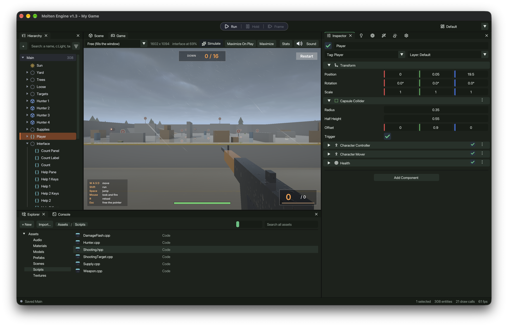
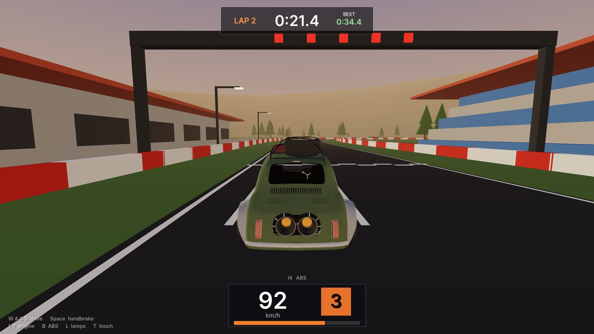
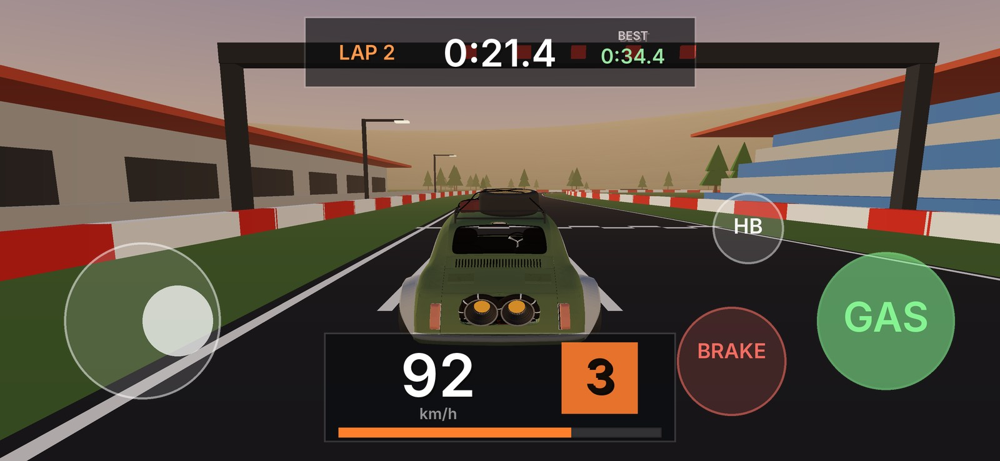

<div align="center">

<picture>
  <source media="(prefers-color-scheme: dark)" srcset="Docs/readme/banner-dark.svg">
  
</picture>

<p>
  <a href="#getting-started"><b>Get started</b></a> ·
  <a href="#the-editor"><b>Editor</b></a> ·
  <a href="#writing-games"><b>Writing games</b></a> ·
  <a href="#engine-features"><b>Engine features</b></a> ·
  <a href="ROADMAP.md"><b>Roadmap</b></a> ·
  <a href="https://gabrielevierti.github.io/moltenengine/"><b>Website</b></a>
</p>

</div>

**Molten Engine** is a native game engine made only for Apple hardware. It is written in C++ on Metal and uses what Apple silicon is good at: tile-based rendering, memoryless render targets, unified memory and hardware-accelerated ray tracing.

You write games with C++ components or visual scripts, build scenes in a full editor, and ship to Mac, iPhone and iPad. No Windows, no Linux, no compatibility layers: just Apple hardware and Metal.



> [!NOTE]
> **Version 1.3, early development.** Everything described here is implemented and available today. Upcoming work and known limitations are in [ROADMAP.md](ROADMAP.md).

<picture>
  <source media="(prefers-color-scheme: dark)" srcset="Docs/readme/features-dark.svg">
  
</picture>

## Made with Molten: Driving

The example game is **Driving**: a Fiat 500 on a small circuit, to lap against the clock. It is a separate download (`MoltenProjects.zip`), not part of the engine: unzip it anywhere and open it with **Open a Project…**.



| | |
| --- | --- |
|  |  |

- **The game.** A 566 m circuit with curbs, walls, a pit lane and lamps, in evening light. Lap times and a best lap kept between games, track limits, tyres that wear and a pit stop to change them, sun, clouds or rain, a title screen, a pause menu and settings, a dashboard, and touch controls.
- **What it shows.** A car simulated from its parts: springs and dampers, tyres that grip and slide, a turbocharged four-cylinder behind a gearbox, stability control that allows a drift, brakes shared by the load on each wheel. Plus a glTF model used in parts with a material each, the game's own scripts in `Assets/Scripts`, and an interface laid out in the Game view.



A tour of the project and its scripts is in [Making Games](Docs/MakingGames.md).

## Getting started

**Requirements:** a Mac with Apple silicon, macOS 13+, Xcode 15+ (or the Xcode Command Line Tools) and CMake 3.24+.

```sh
brew install cmake
```

Clone the repository and build:

```sh
git clone https://github.com/gabrielevierti/moltenengine.git
cd moltenengine
cmake -B build -DCMAKE_BUILD_TYPE=Release
cmake --build build -j
```

Then launch the editor, or run a game without it:

```sh
./build/molten                   # the editor
./build/molten-player MyGame     # a game, without the editor
```

Prefer Finder? Double-click `build.command`: it builds the project and saves the output to `build.log`.

The first configuration downloads the dependencies: GLFW, metal-cpp, stb, miniaudio, Dear ImGui and ImGuizmo.

## The editor

A complete visual editor that makes game development approachable without taking control away. Its workflows will feel familiar, but it is built for this engine.

<table>
<tr>
<td valign="top" width="50%">

**Workspace**

- Hierarchy, Scene, Game, Inspector, Explorer and Console panels
- Dockable, rearrangeable tabs; save, export and import layouts
- An icon for every panel, tool, component and asset type; tabs in a narrow dock shrink to their icons
- Opening a project shows each loading step, its timing, and any warning or error
- Console with categories, search and collapsed duplicates
- Independent Scene and Game cameras
- Play and Stop, with the scene restored afterwards

**Scene editing**

- Move, rotate and scale tools, in world or local space, with snapping
- Fly camera (right mouse button + WASD) and Alt-drag orbit
- **F** frames the selection
- Collider visualization
- Lights, cameras, particle systems and sounds shown by their icons in the view

**Asset management**

- Folder and tile asset browser with automatic previews for models, scenes and materials
- Drag and drop models into the scene, and materials onto objects
- Create assets from the context menu
- Import settings kept in `.meta` files

</td>
<td valign="top" width="50%">

**Assets in the Inspector**

- 3D models, materials and texture maps
- Audio with trimming, fading, looping and normalization
- Particle effects with live playback

**Materials and shaders**

- Physically based, unlit and water materials
- Custom shaders in `.shader` files, compiled when you save

**UI editor**

- Text, panels, images, progress bars, dials and buttons
- Touch buttons and virtual sticks
- Anchors and responsive scaling, positioned right in the Game view
- iPhone and iPad screen presets

**Build and export**

- A dedicated Build window for **macOS, iOS and iPadOS** apps
- For iOS it generates the Xcode project, builds the app and installs it on a connected device

**Workflow:** undo for editor operations, one log for engine and game, persistent layouts, built-in project management, and six templates to start from (car, plane, boat, third person, first-person shooter, online).

</td>
</tr>
</table>

## Writing games

Games are written in C++ with components. Every `.cpp` file in `Assets/Scripts` is compiled into the game automatically, and saving a script rebuilds it.

A component is a regular C++ struct with a short declaration:

```cpp
#include "MoltenMetal.hpp"
using namespace molten;

struct Spinner {
    float degreesPerSecond = 90;

    void update(World& world, Entity self, float dt) {
        if (Transform* transform = world.scene.get<Transform>(self))
            transform->rotation = transform->rotation *
                Quat(radians(degreesPerSecond * dt), Vec3{0, 1, 0});
    }
};

MOLTEN_COMPONENT(
    Spinner,
    MOLTEN_FIELD(degreesPerSecond).range(-720, 720)
)
```

Its fields appear in the Inspector and are saved with the scene, and `update` runs every frame while the game is playing.

**Visual scripting.** Rather build gameplay visually? About 40 nodes cover events and logic, transforms, physics, input, maths and variables. The graph editor zooms, searches and works together with your C++ components.

**Built-in gameplay.** Many common mechanics need no code at all: player movement, follow cameras, pickups and collectibles, health and damage, shooting and spawning, scores, and vehicle controllers.

| Guide | What's in it |
| --- | --- |
| [Making Games](Docs/MakingGames.md) | From an empty editor to something you can play, with the Driving example |
| [Game Code](Docs/GameCode.md) | Writing components in C++ |
| [Visual Scripting](Docs/VisualScripting.md) | Gameplay without code |
| [Editor Plugins](Docs/Plugins.md) | Extending the editor |
| [API Reference](Docs/API.md) | Every class and function a game can use, from the headers |
| [File Formats](Docs/FileFormats.md) | What each saved file holds, and what stays compatible |

## Engine features

<table>
<tr>
<td valign="top" width="50%">

**Rendering**, a Metal pipeline designed for Apple GPUs

- Physically based rendering, HDR and multisampling
- Cascaded shadow maps; directional, point and spot lights (up to 63 point and spot), with shadows for the nearest and brightest
- Spot light cookies, and volumetric lights that show as beams in fog
- **Hardware ray tracing:** shadows, ambient occlusion, reflections and single-bounce lighting
- Image-based lighting and normal maps
- Transparent and cut-out materials
- Procedural sky, clouds that drift with the wind, and fog; volumetric light shafts
- Water rendering
- Bloom, tone mapping and lens effects

**Particles and effects**

- Modular particle systems: shape-based and burst emission, turbulence, wind, trails
- Collision with colliders; soft and lit particles; reusable `.effect` assets
- Weather: rain that runs down surfaces with the wind and the object's speed, beading on paint and soaking into stone; snow that settles

</td>
<td valign="top" width="50%">

**Physics**

- Rigid bodies and contacts
- Sphere, box, capsule and mesh colliders
- Joints, triggers, raycasts and collision layers
- Vehicle physics: wheels, suspension, engines and aerodynamic wings
- Cloth (flags, sails, curtains) that collides with the scene; ropes and ragdolls

**Core systems**

- Entity-component architecture with a parent-child transform hierarchy
- Keyboard, mouse, gamepad and touch input, with configurable actions
- Audio mixer
- glTF and OBJ import, with access to individual glTF meshes (`car.glb#3`)
- Human-readable scene files
- Headless rendering and frame capture:

```sh
./build/molten-player MyGame --capture frame.png
```

</td>
</tr>
</table>

How it all fits together, and why, is in [ARCHITECTURE.md](ARCHITECTURE.md).

## Apple platforms

| Platform | Minimum version |
|---|---|
| macOS | 13+ |
| iOS | 16+ |
| iPadOS | 16+ |

The editor runs on Apple silicon Macs. Games are built for iPhone and iPad straight from the editor's **Build** window; installing on a device needs an Apple Developer Team ID.

<details>
<summary><b>Building for iOS by hand</b></summary>

<br>

```sh
cmake -B build-ios -G Xcode \
  -DCMAKE_SYSTEM_NAME=iOS \
  -DMOLTEN_IOS_PROJECT=/path/to/MyGame \
  -DMOLTEN_IOS_TEAM=YOURTEAMID

open build-ios/MoltenMetalEngine.xcodeproj
```

Platform details and current limitations are in [Docs/iOS.md](Docs/iOS.md).

</details>

## Project structure

```text
Engine/       core engine systems: Core, Scene, Rendering, Physics, Audio, Input,
              Assets, Project, Kit, Platform
Editor/       visual editor and editor API
Player/       standalone game runtime
Plugins/      editor plugins
Shaders/      Metal shaders and shared GPU definitions
Assets/       engine assets, fonts, logos and icons
Tests/        automated unit tests
Templates/    new project templates
Tools/        asset, template, icon font and logo tools
Website/      the project website
```

## Origins

Molten Engine grew out of the [LearnMetal Engine](https://github.com/gabrielevierti/learnmetal-engine), the engine written for the [LearnMetal](https://gabrielevierti.github.io/learnmetal/) tutorials.

## License

Molten Engine is released under the **GNU General Public License v3.0**. See [LICENSE](LICENSE).

Third-party dependencies keep their own licenses: MIT, zlib, public domain and Apache 2.0 (metal-cpp). The car in the Driving example is "Fiat 500 x Outlaw" by Subin, under CC BY 4.0.

---

<div align="center">
<sub><b>Molten Engine</b> · Built for Apple silicon. Powered by Metal.<br>Made by <a href="https://github.com/gabrielevierti">Gabriele Vierti</a> in Milan.</sub>
</div>
